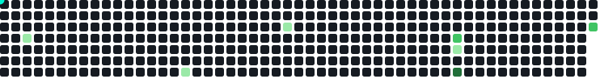

<!-- ═══════════════════════ HEADER ═══════════════════════ -->
<div align="center">


<a href="https://github.com/Shifat1667">
  
</a>

<br/>


</div>

<!-- ═══════════════════════ ABOUT ═══════════════════════ -->
## About

I'm a Computer Science & Engineering student focused on **systems programming, operating system kernels, and CPU scheduling optimization**. I enjoy working close to the metal, where performance, correctness, and resource management really matter.

<table>
<tr>
<td width="60%" valign="top">

```yaml
name:       Foysal Hasan Shifat
handle:     "@Shifat1667"
education:  B.Sc. in Computer Science & Engineering
focus:      [Systems Programming, OS Kernels, CPU Scheduling]
languages:  [C++17, C, Python, JavaScript, SQL]
platforms:  [Linux (xv6), Windows, POSIX]
status:     Building high-performance systems
fun_fact:   I debug race conditions for breakfast
```

</td>
<td width="40%" valign="top">

**Currently**

- Building CPU scheduling optimization systems
- Deep diving into OS and kernel programming
- Studying advanced algorithms and data structures
- Contributing to open-source systems software

</td>
</tr>
</table>

<!-- ═══════════════════════ TECH STACK ═══════════════════════ -->
## Tech Stack

<div align="center">

**Languages**


**Systems & Tooling**


**Core Concepts**


</div>

<!-- ═══════════════════════ PROJECTS ═══════════════════════ -->
## Featured Projects

<table>
<tr>
<td width="50%" valign="top">

### [CPU Scheduling Optimizer PRO](https://github.com/Shifat1667/cpu-scheduling-optimizer)

Real-time process monitoring, five CPU scheduling algorithms, and a multi-criteria optimization engine with an interactive GUI.


<a href="https://github.com/Shifat1667/cpu-scheduling-optimizer"></a>
<a href="https://github.com/Shifat1667/cpu-scheduling-optimizer"></a>

</td>
<td width="50%" valign="top">

### [xv6 System Calls Project](https://github.com/Shifat1667/Cse323-Project)

Extended the xv6 kernel with `getchildren()` and `trace()` system calls for better process management and debugging.


<a href="https://github.com/Shifat1667/Cse323-Project"></a>
<a href="https://github.com/Shifat1667/Cse323-Project"></a>

</td>
</tr>
<tr>
<td width="50%" valign="top">

### [Nexus CRM System](https://github.com/Shifat1667/Nexus_Crm)

A complete CRM solution with customer management, analytics, and reporting.


<a href="https://github.com/Shifat1667/Nexus_Crm"></a>
<a href="https://github.com/Shifat1667/Nexus_Crm"></a>

</td>
<td width="50%" valign="middle" align="center">

### More on the way

Currently working on additional systems programming and optimization projects.

**[Browse all repositories →](https://github.com/Shifat1667?tab=repositories)**

</td>
</tr>
</table>

<!-- ═══════════════════════ STATS ═══════════════════════ -->
## GitHub Analytics

<div align="center">


<br/>


</div>

<!-- ═══════════════════════ CONTACT ═══════════════════════ -->
## Let's Connect

<div align="center">

<a href="https://github.com/Shifat1667"></a>
<a href="https://www.linkedin.com/in/foysal-hasan-shifat-311b68295/"></a>
<a href="https://www.facebook.com/foysalhasan.shifat.9"></a>
<a href="mailto:foysalshifat@gmail.com"></a>

<br/><br/>

<i>"Always learning, always optimizing — from kernel syscalls to scalable applications."</i>

<br/><br/>




</div>
